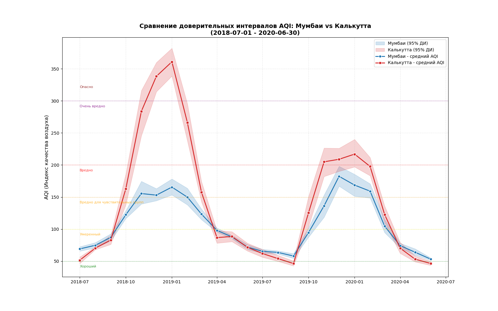
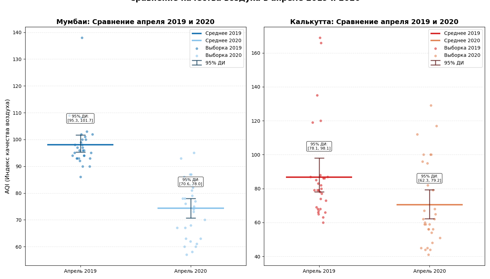

# Анализ качества воздуха в Индии: бутстреп и доверительные интервалы 🌫️

*Учебный проект в рамках программы профессиональной переподготовки «Аналитик данных» (НИУ ВШЭ), 2025–2026.*

## 📌 О проекте

Данный проект выполнен в рамках домашнего задания по курсу «Прикладная статистика» программы переподготовки НИУ ВШЭ. Задача — проанализировать реальные данные об индексе качества воздуха (AQI) в двух крупнейших мегаполисах Индии — Мумбаи и Калькутте — и построить доверительные интервалы для среднего значения AQI с помощью **бутстрепа**.

## 📌 Цель проекта

Отработать практические навыки статистического анализа данных:
- **работа с временными рядами** — фильтрация по датам, выделение месяца и года;
- **бутстреп** — построение доверительных интервалов без предположений о параметрическом семействе распределений;
- **визуализация** — доверительные интервалы, средние значения, точки выборки на одном графике;
- **сравнительный анализ** — оценка статистической значимости различий между двумя выборками по перекрытию доверительных интервалов.

---

## 📁 Данные

- **Источник:** датасет `city_day.csv` (Kaggle: Air Quality Data in India)
- **Столбцы:** `City`, `Date`, `AQI` (и другие показатели загрязнения)
- **Обработка:** удалены пропуски в `AQI`; добавлены поля `Year` и `Month`
- **Города:** Мумбаи (Mumbai), Калькутта (Kolkata)
- **Период:** с 1 июля 2018 года включительно

---

## 🎯 Задание 1 — Загрузка и подготовка данных

### 📊 Что сделано
- Загрузка `city_day.csv` с аргументом `parse_dates=['Date']`.
- Сохранение только столбцов `City`, `Date`, `AQI`; удаление пропусков.
- Добавление столбцов `Year` и `Month`.
- Фильтрация данных по двум городам и дате `>= 2018-07-01`.
- Построен линейный график AQI по датам для обоих городов (для визуальной оценки сезонности).

---

## 🎯 Задание 2 — Бутстрепные доверительные интервалы

### 📊 Что сделано
Для каждого месяца с июля 2018 по июнь 2020 включительно построен **бутстрепный доверительный интервал** для среднего значения AQI:
1. Для каждого месяца из выборки `N` значений строится `k = 1000` бутстрепных выборок (с возвращением).
2. Для каждой бутстрепной выборки вычисляется среднее.
3. По вариационному ряду средних находятся квантили для уровня доверия `α = 0.95`.

### 📈 Ключевые результаты

| Месяц | Мумбаи (среднее) | Калькутта (среднее) |
|-------|-------------------|----------------------|
| 2018-07 | 69.17 | 51.61 |
| 2018-08 | 74.81 | 70.32 |
| 2018-09 | 87.23 | 83.07 |
| 2018-10 | 122.46 | 163.06 |
| 2018-11 | 155.46 | 283.67 |

Полные результаты сохранены в `DataFrame` и использованы для построения графиков.

---

## 🎯 Задание 3 — Визуализация доверительных интервалов

### 📊 Что сделано
Построен **единый график** для Мумбаи и Калькутты:
- закрашенные области — 95% доверительные интервалы (синий для Мумбаи, красный для Калькутты);
- точки с линиями — истинные средние значения AQI;
- горизонтальные пунктирные линии — уровни качества воздуха (Хороший, Умеренный, Вредный и т.д.);
- подписи уровней качества.

> 📷 **График доверительных интервалов AQI:**  
>   
> *(График сохранён в папке `images/`)*

### 📈 Сводная статистика

| Показатель | Мумбаи | Калькутта |
|------------|--------|-----------|
| Средний AQI | 107.6 ± 40.7 | 143.0 ± 94.3 |
| Мин. среднемесячный AQI | 53.3 | 46.4 |
| Макс. среднемесячный AQI | 182.3 | 360.8 |
| Средняя ширина ДИ | 15.7 | 27.5 |

### 🧠 Вывод
В Калькутте как средний уровень AQI, так и разброс значений значительно выше, чем в Мумбаи. Это отражается и в более широких доверительных интервалах для Калькутты.

---

## 🎯 Задание 4 — Закономерности на графике

### 📊 Что сделано
Проанализирован график доверительных интервалов и выявлена сезонная закономерность.

### 🧠 Вывод
На графике прослеживается **повышение уровня AQI с октября по март** каждого года. Это связано с:
- **муссонами** — с октября по март дует сухой северо-восточный муссон, а с июня по сентябрь — влажный юго-западный, приносящий обильные дожди;
- **промышленностью** — Мумбаи (нефтепереработка, финансы, порт) и Калькутта (чёрная металлургия, машиностроение, джутовая промышленность) — крупнейшие промышленные центры;
- **туристическим сезоном** — с октября по март в Индии начинается наплыв туристов и транспорта.

В Калькутте из-за чёрной металлургии показатели AQI в целом выше, чем в Мумбаи.

---

## 🎯 Задание 5 — Сравнение апреля 2019 и апреля 2020

### 📊 Что сделано
Построен **единый график** для каждого города:
- доверительные интервалы для апреля 2019 и апреля 2020;
- истинные средние значения (`plt.hlines`);
- точки выборки (с джиттером);
- значения 95% ДИ подписаны на графике.

> 📷 **Сравнение апреля 2019 и 2020:**  
>   
> *(График сохранён в папке `images/`)*

### 📈 Ключевые результаты

| Город | Апрель 2019 | Апрель 2020 | Разница | Перекрытие ДИ |
|-------|-------------|-------------|---------|----------------|
| Мумбаи | 98.07 [95.30, 101.70] | 74.33 [70.63, 78.03] | −23.73 | ❌ Нет — значимое уменьшение |
| Калькутта | 86.80 [78.13, 98.07] | 70.37 [62.30, 79.20] | −16.43 | ✅ Есть — не значимо |

---

## 🎯 Задание 6 — Выводы

### 📊 Анализ доверительных интервалов

**Мумбаи:**
- ДИ для 2019 и 2020 **не пересекаются**.
- Это свидетельствует о **статистически значимом различии** между средними значениями AQI.
- Снижение AQI на ~24 пункта — существенный результат для здоровья населения.
- Вероятная причина — **локдаун во время пандемии COVID-19** (апрель 2020 — начало строгого локдауна в Индии).

**Калькутта:**
- ДИ для 2019 и 2020 **перекрываются**.
- Несмотря на снижение среднего (с 86.80 до 70.37), это изменение **не является статистически значимым** на 95% уровне доверия.
- Высокое стандартное отклонение (27.28 и 24.11) указывает на сильный разброс данных, из-за чего «шум» скрывает эффект.

### 🧠 Прикладные выводы

- **Проблема «шума» в данных:** высокое стандартное отклонение в Калькутте говорит о неоднородности уровня загрязнения в течение месяца (возможны дни с очень чистым воздухом и дни с пиками). Из-за этого снижение среднего «теряется».
- **Разные исходные условия:** в 2019 году Мумбаи был более загрязнён (98.07), чем Калькутта (86.80), но к 2020 году города почти сравнялись (74.33 vs 70.37). Однако из-за статистической погрешности в Калькутте нельзя утверждать, что они стали «одинаково чистыми».
- **Формальная проверка:** для корректной оценки значимости различий нужно строить доверительный интервал для **разности средних** и проверять, пересекает ли он ноль. Однако предварительная оценка по перекрытию доверительных интервалов уже даёт полезную информацию: если ДИ не пересекаются — различие заведомо значимо; если пересекаются — требуется дополнительная проверка.

---

## 🔧 Инструменты и стек

- **Язык:** Python 3.13
- **Обработка данных:** `pandas`, `numpy`
- **Бутстреп:** `numpy.random.choice`
- **Визуализация:** `matplotlib.pyplot`
- **Среда:** Jupyter Notebook

## 📊 Итоги проекта

| Задача | Подход | Ключевой результат |
|--------|--------|--------------------|
| Подготовка данных | `pandas` | Данные за 2018–2020 по двум городам |
| Бутстреп | 1000 выборок на месяц | ДИ для среднего AQI по месяцам |
| Визуализация | `fill_between`, `errorbar` | Единый график с ДИ для двух городов |
| Сезонность | Анализ графика | Рост AQI с октября по март |
| Сравнение апрель 2019/2020 | Перекрытие ДИ | Мумбаи — значимое снижение; Калькутта — нет |

## 🧠 Отработанные концепции

- **Бутстреп:** построение доверительных интервалов без предположений о распределении.
- **Временные ряды:** группировка по месяцам и годам, сезонный анализ.
- **Визуализация ДИ:** `fill_between`, `errorbar`, `hlines`, `scatter` с джиттером.
- **Статистическая значимость:** оценка по перекрытию доверительных интервалов.
- **Прикладная интерпретация:** влияние локдауна, промышленности и сезонности на качество воздуха.

## 📁 Структура репозитория

```
air_quality_bootstrap/
├── README.md
├── notebooks/
│ └── stat_HW-3.ipynb
├── data/
│ └── city_day.csv
├── images/
│ ├── air_quality_di.png
│ └── air_quality.png
└── requirements.txt
```

## 📝 Статус

✅ Проект завершён